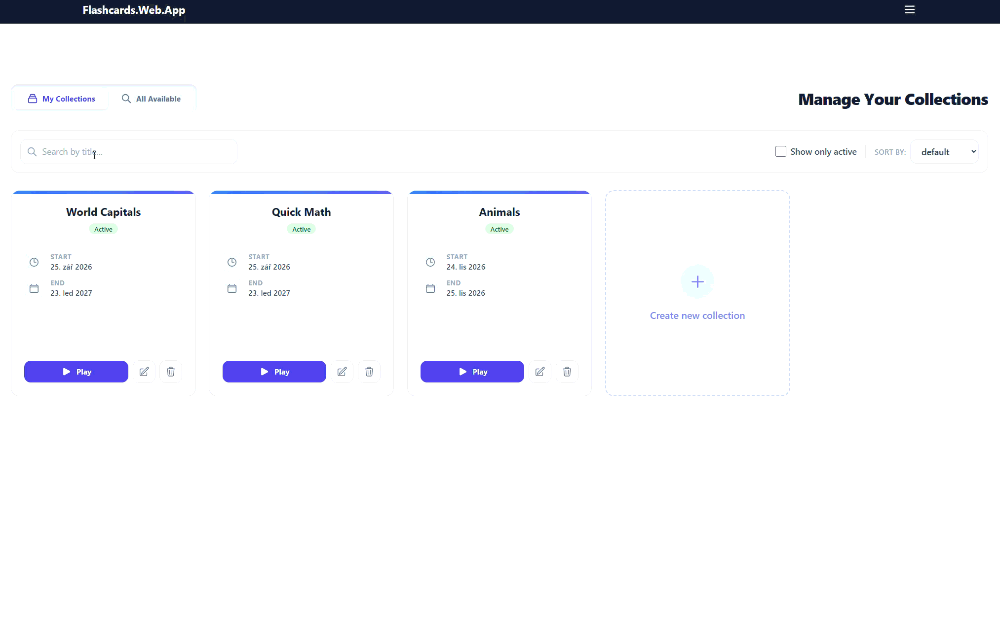
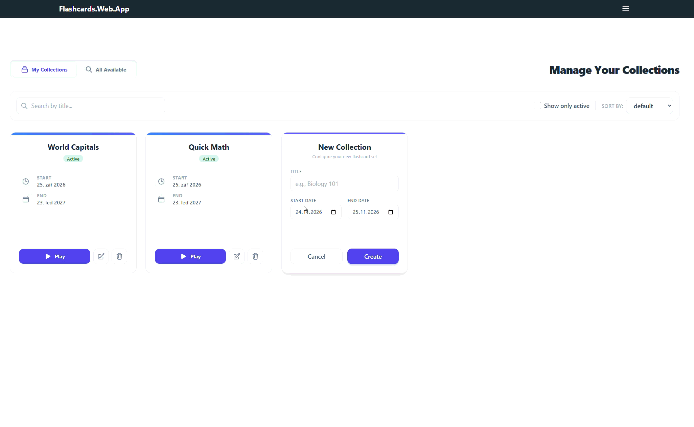
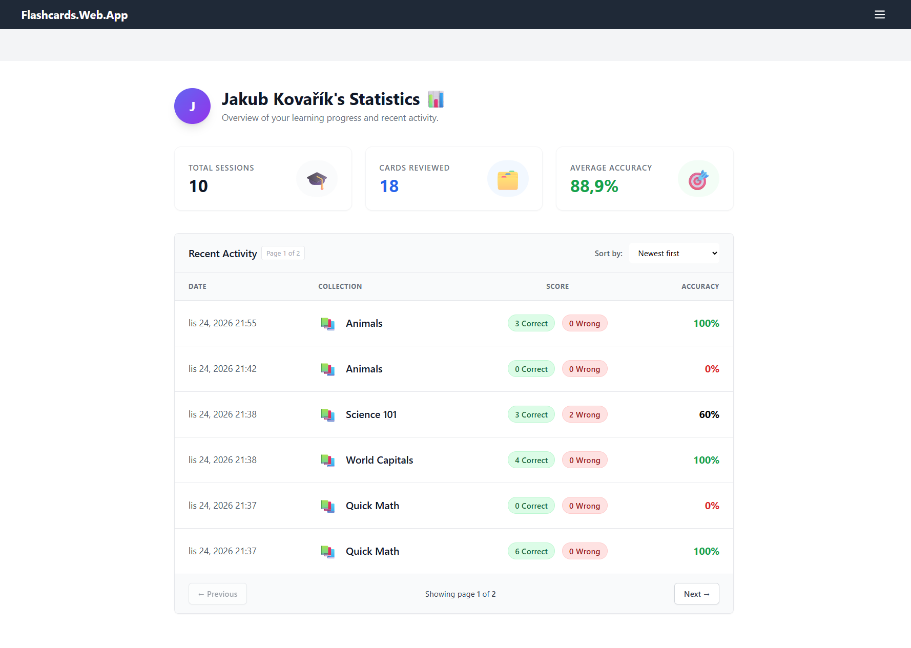
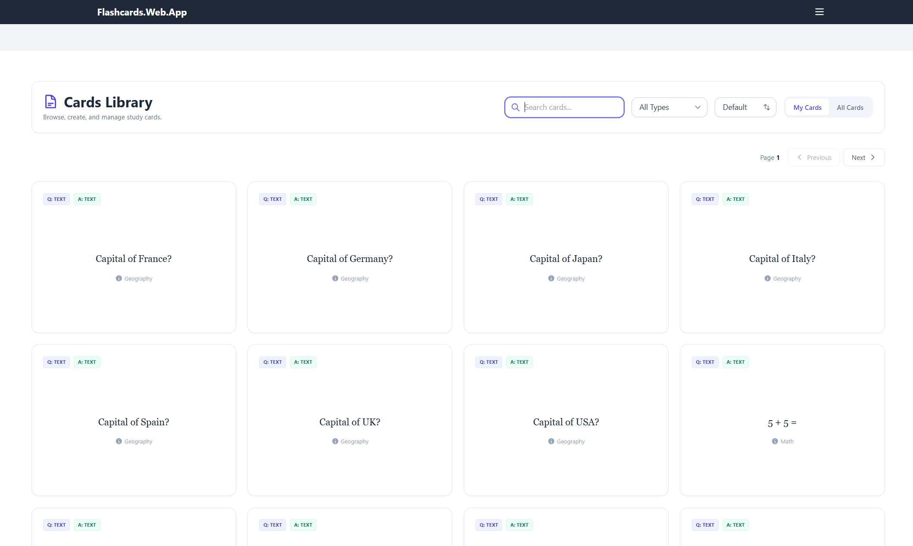
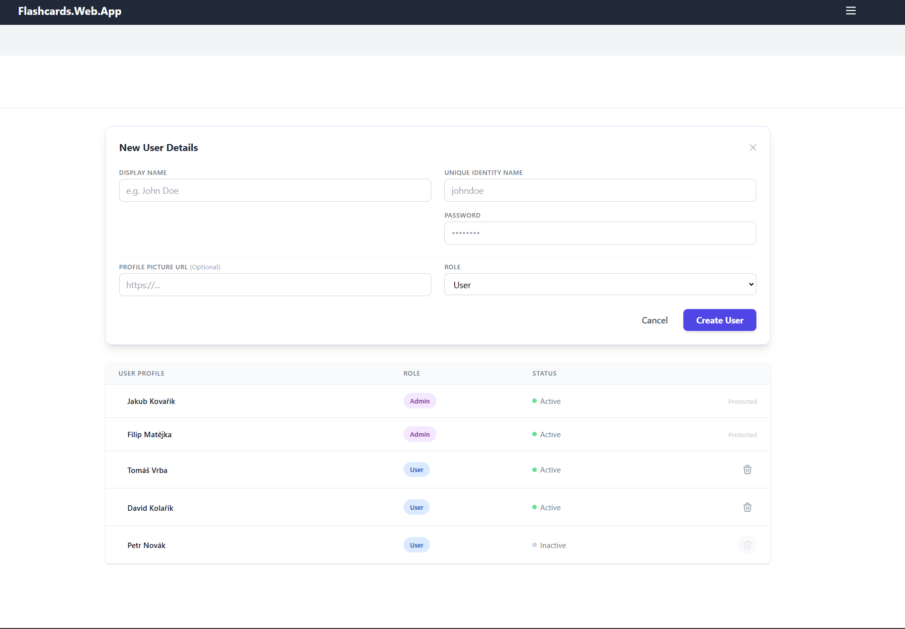

# Flashcards — Clean Architecture .NET Web App

A full-stack flashcard learning app. Users build card collections with text or image cards, study them in timed lessons and track progress on a statistics page. Admins manage users from a separate panel.

It was built as a team university project on **.NET 9**. It is split into three independently deployable apps: a **Blazor WebAssembly** frontend, a **REST API** and a **Duende IdentityServer**. The three apps communicate over **OpenID Connect / OAuth 2.0** with **JWT** access tokens.

**Highlights**

- **Clean Architecture.** Each app is layered into 
  - `App` (presentation/hosting), 
  - `BL` (business logic: facades, mappers, services) 
  - `DAL` (entities, repositories)
  -  shared `Common` projects. Repositories rely on interfaces, so the API's storage can be swapped. The current build uses an in-memory store.
- **Authentication and authorization.**
  - Duende IdentityServer is backed by **ASP.NET Core Identity** and **EF Core** (SQL Server).
  - The **Blazor** client signs in with the Authorization Code flow and **PKCE**.
  - The API validates **JWT bearer** tokens and applies role-based (`Admin` / `User`) and ownership-based authorization.
  - The API calls IdentityServer with a Client Credentials token to provision and delete user identities.
- **Minimal APIs** with OpenAPI/Swagger (NSwag). The typed C# API client used by the frontend is **generated from the OpenAPI spec**.
- **Blazor WebAssembly SPA** styled with **Tailwind CSS**, with form validation via **FluentValidation**.
- **Testing**: about 70 xUnit tests across unit tests (NSubstitute mocks), repository integration tests and endpoint tests (`WebApplicationFactory`).
- **CI/CD** with **Azure DevOps Pipelines**: build, test and publish to **Azure App Service**. Logging uses **Serilog**.

**Tech stack:** C# · .NET 9 · ASP.NET Core Minimal APIs · Blazor WebAssembly · Duende IdentityServer 7 · ASP.NET Core Identity · Entity Framework Core · SQL Server · JWT / OIDC / OAuth 2.0 · NSwag · FluentValidation · Tailwind CSS · xUnit · NSubstitute · Serilog · Azure DevOps · Azure App Service

---

## Showcase

### Browsing and playing collections
Filter and sort card collections, then start a lesson and go through the cards.



### Creating a collection
Create a new card collection and add a card with text or an image.



### Statistics
Per-user overview of study sessions, reviewed cards and accuracy, with a sortable, paginated history of recent lessons.



### Cards
Browse all your cards easily with paginated and filterable overview.




### User management (admin)
Admin panel for adding users to the system. Creating a user here also creates the matching login identity in IdentityServer.



---

## Architecture

```
┌──────────────────────┐   OIDC (Auth Code + PKCE)   ┌───────────────────────────┐
│  Flashcards.Web      │ ──────────────────────────▶ │  Flashcards.Identity      │
│  Blazor WASM SPA     │                             │  Duende IdentityServer    │
└─────────┬────────────┘                             │  ASP.NET Identity + EF/SQL│
          │ JWT bearer                               └─────────────▲─────────────┘
          ▼                                                        │ Client Credentials
┌──────────────────────┐                                           │ (user provisioning)
│  Flashcards.Api      │ ──────────────────────────────────────────┘
│  Minimal API         │
└──────────────────────┘
```

## Running locally

**Prerequisites:** .NET 9 SDK, SQL Server LocalDB (or any SQL Server), Node.js (for the Tailwind build), and a trusted HTTPS dev certificate (`dotnet dev-certs https --trust`).

1. **Identity database.** Set `ConnectionStrings:DefaultConnection` in `Flashcards.IdentityProvider.App/appsettings.Development.json`, then apply the migrations:
   ```bash
   cd Flashcards.IdentityProvider.App
   dotnet ef database update --project ../Flashcards.IdentityProvider.DAL --startup-project .
   ```
2. **Frontend dependencies:**
   ```bash
   cd Flashcards.Web.App && npm install
   ```
3. **Start the three apps** (or set them as multiple startup projects in Visual Studio):
   ```bash
   dotnet run --project Flashcards.IdentityProvider.App                          # https://localhost:5001
   dotnet run --project Flashcards.Api.App --launch-profile Flashcards.Api       # https://localhost:7115 (Swagger at /swagger)
   dotnet run --project Flashcards.Web.App                                       # https://localhost:44355
   ```
4. **Sign in.** The API starts with sample data. Register an identity at `https://localhost:5001/Account/Create` with the username `Jakub`. It maps to a seeded admin account, and IdentityServer grants it the `Admin` role on startup (`Seed:AdminUserNames`).

Run the tests with:
```bash
dotnet test
```
